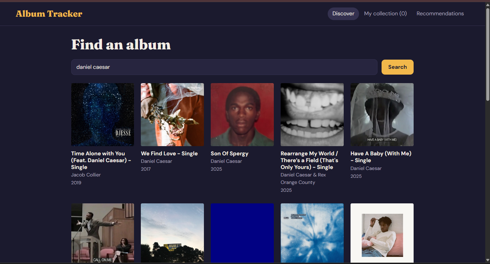

# Album Tracker

A React music web app with Deezer playback, AI-powered recommendations, and custom listening log management.

---

## Screenshot & Live Demo



Live Demo: https://album-tracker-wency.vercel.app/

---

## Features

- Album Discovery: Search for artists or albums and instantly fetch metadata via the iTunes API.
- Audio Previews: Play 30-second music samples using a persistent, sticky media player.
- Personal Collection Manager: Track albums by status (Want to listen, Listening, Listened).
- Custom Ratings & Notes: Assign 1–5 star ratings and keep personal notes saved locally.
- Sorting & Filtering: Filter collection entries by listening status and sort by title, artist, or rating.
- External Integration: Quick-launch links to listen on Spotify, YouTube, Apple Music, and Deezer.
- Smart AI Insights: AI-powered album summaries and recommendations via Gemini.

---

## Tech Stack

- React
- Vite
- Context API & Custom Hooks
- iTunes Search API, Deezer API, Google Gemini API
- Vercel

---

## How to Run Locally

Follow these steps to set up and run the project locally on your machine:

1. Clone the repository:

   ```bash
   git clone https://github.com/wcruzat-web/album-tracker.git
   cd album-tracker
   ```

2. Install dependencies:

   ```bash
   npm install
   ```

3. Create a local environment file:
   Create a file named `.env.local` in the root directory and add your required environment variables:

   ```env.local
   VITE_GEMINI_API_KEY=your_gemini_api_key_here
   ```

4. Start the development server:

   ```bash
   npm run dev
   ```

5. Open your browser and navigate to `http://localhost:5173`.

---

## Limitations

- 30-Second Previews: Audio tracks provided by the iTunes API are limited to 30-second preview clips.
- Browser-Only Storage: Your saved collection, ratings, and notes are stored in your browser's localStorage and will not sync across different devices or browsers.
- Deezer Account Requirement: Full-length track playback on Deezer requires an active Deezer login and account subscription.

---

## Privacy Note & Disclaimer

- Privacy Note: This application uses AI features powered by Google Gemini to provide music insights and recommendations. No personal identifiable information (PII) or stored collection data is sold or shared beyond sending standard search context to the AI model.
- Disclaimer: This project is an independent educational tool and is not affiliated, associated, authorized, endorsed by, or in any way officially connected with Apple Inc. (iTunes), Spotify, Deezer, or Google LLC (Gemini). All product and company names are trademarks or registered trademarks of their respective holders.
